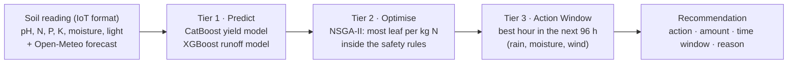

# SmartTea-LK · Component 04: AI-Based Tea Plantation Resource Optimization

**Decides, for each tea block, what to do next, how much, and when** (fertilizer, irrigation, fungicide and soil-pH correction), using the live soil reading and the weather forecast, so each block gets the least input for the most growth and nothing is applied just before heavy rain.

University research project (CSP 001), part of the SmartTea-LK initiative for the Sri Lankan tea sector. The scope is agronomic only: no cost, labour or machinery variables.

    

---

## Contents
- [How it works](#how-it-works)
- [Results](#results)
- [Data](#data)
- [Getting started (Windows)](#getting-started-windows)
- [Using the dashboard](#using-the-dashboard)
- [Repository structure](#repository-structure)
- [Reproduce the data and models](#reproduce-the-data-and-models)
- [API](#api)
- [Tests](#tests)
- [Documentation](#documentation)
- [Limitations](#limitations)
- [Data sources and licences](#data-sources-and-licences)

---

## How it works

Every new reading, and every hour as the forecast changes, a block's data runs through three tiers:



| Tier | What it does |
|---|---|
| **1. Prediction** | A **CatBoost** model predicts the yield of a plucking round. An **XGBoost** model predicts the % of fertilizer that rain will wash away, using the *forecast* rain, slope and soil moisture; more forecast rain can never lower its prediction (monotone rule). |
| **2. Optimizer** | **NSGA-II** (pymoo) searches nitrogen doses and irrigation within the operational limits. A learned soil-N response carries each dose's effect over the next 90 days, and the runoff model picks the product that loses least. A dose is recommended only if each kg of N adds at least 3.5 kg of green leaf. |
| **3. Action Window** | Scans the hourly forecast for the best time: at most 5 mm rain and 30 % rain chance in the 12 h after fertilizer, soil moisture in the allowed band, wind ≤ 4 m/s for spraying, working hours 06:00–16:00. Rule-based checks add fungicide (blister-blight risk), dolomite (pH < 4.45) and irrigation (soil below the trigger, little rain coming). |

Example output:

```json
{"block_id": "E03-B07", "action": "Apply fertilizer", "amount_kg_per_ha": 135,
 "window": "2026-10-22 06:00–10:00", "reason": "Soil moisture in band; 0.4 mm rain in the 12 h after",
 "predicted_yield_change_pct": 10.9, "efficiency_score": 0.87}
```

Every formula (model training, metrics, soil-N response, optimizer, scheduler rules and the data simulation) is written out in [`docs/SmartTea_LK_C04_Formulas_and_Methods.pdf`](docs/SmartTea_LK_C04_Formulas_and_Methods.pdf).

---

## Results

Settings were chosen on 2024 data only, and 2025 was scored once. "New blocks + new year" is the hardest test: blocks and a year the model never saw.

| Model | Measure | Test year 2025 | New blocks + new year |
|---|---|---|---|
| Yield (CatBoost) | R² (variation explained) | **0.91** (MAE 1.63 kg/ha/day) | **0.80** |
| Runoff risk, high / low (XGBoost) | Accuracy / F1 | **0.81 / 0.82** (guessing: 0.54) | **0.79 / 0.81** |
| Runoff amount (XGBoost) | R² | 0.57 | 0.44 |
| Runoff amount with the rain that actually fell (upper bound) | R² | 0.94 | 0.90 |

- **Forecast error, not the model, limits runoff prediction:** the same model reaches 0.94 when given the real rain.
- **Seven models were compared** (Ridge, Random Forest, HistGradientBoosting, XGBoost, LightGBM, CatBoost, MLP); the four boosting models were within about 0.03 of each other.

**Optimizer, full-year closed-loop test on 2025 (all 50 blocks):**

| Per hectare per year | Historical practice | Optimizer |
|---|---|---|
| Nitrogen applied | 198 kg | 182 kg (−8 %) |
| Nitrogen lost to runoff | 59 kg | 36 kg (−40 %) |
| Predicted green leaf | 7,519 kg | 7,776 kg (+3.4 %) |
| Safety-rule breaks | 0 | 0 |

The optimizer's yield figures are model predictions, not field measurements.

---

## Data

The dataset is a **hybrid**: the environment is real, and the farm management on top of it is simulated, because no public dataset has block-level tea sensors, fertilizer timing and yield for Sri Lanka.

- **Study area:** 5 real tea-growing locations × 10 blocks = **50 blocks**, daily, **2021-01-01 to 2025-12-31**. The estate names E01–E05 are labels; the places are real.

| Estate | Region | Zone | Latitude | Longitude |
|---|---|---|---|---|
| E01 | Nuwara Eliya | Up-country | 6.97 | 80.78 |
| E02 | Hatton / Dimbula | Up-country | 6.89 | 80.60 |
| E03 | Kandy | Mid-country | 7.25 | 80.65 |
| E04 | Ratnapura | Low-country | 6.68 | 80.40 |
| E05 | Deniyaya / Matara | Low-country | 6.34 | 80.56 |

| Real | Simulated on the real weather and soil |
|---|---|
| Hourly weather and rain timing (ERA5) | Fertilizer, irrigation, fungicide and dolomite decisions |
| Issued weather forecasts (real from 2024-01-20) | Crop growth and yield |
| Soil properties for every block (SoilGrids) | Fertilizer runoff amounts |
| National tea production by elevation | Sensor noise and ~1.5 % missing readings |

- **Data layers:** `data/raw` (original downloads + `MANIFEST.csv` with SHA-256 checksums) → `data/interim/real` → `data/processed/hybrid` → **`data/model_ready`** (feed-ready tables).
- **Training tables:**
  - yield: 9,053 plucking rounds, 57 inputs;
  - runoff: 850 fertilizer applications, 24 inputs.
- **Only decision-time information is used as model input;** facts known only afterwards are prefixed `hindsight__`.
- **Data guide and dictionary:** [`md_files/data/README.md`](md_files/data/README.md) and [`md_files/data/DATA_DICTIONARY.md`](md_files/data/DATA_DICTIONARY.md).

---

## Getting started (Windows)

**One-time setup on a new PC.** Double-click **`setup.bat`** (about 20–30 minutes the first time):
1. Installs what is missing with winget: Python 3.14, Java 21 (Temurin), Node.js LTS, MongoDB. It downloads Maven 3.9.9 from Apache and checks its checksum.
2. Creates `.venv` with the exact package versions in `requirements-lock.txt`, installs the dashboard packages and builds the backend.
3. Retrains the models (`artifacts/` is not stored in Git), then checks the data checksums and runs the tests.

Requirements: Windows 10 or 11 with winget ("App Installer" from the Microsoft Store) and an internet connection. Accept the administrator prompts.

**Day to day:**

| File | What it does |
|---|---|
| `start.bat` | Starts MongoDB (if stopped), the ML service, the backend and the dashboard, each in its own window, then opens http://localhost:5173 |
| `stop.bat` | Stops all three (MongoDB keeps running as a Windows service) |
| `setup.bat` | Run again after code changes: rebuilds the backend cleanly. `setup.bat retrain` also retrains the models |

**Manual start** (three terminals, from the project root):

```bash
# 1. ML service (FastAPI)            http://localhost:8000/docs
.venv\Scripts\activate
uvicorn src.api.main:app --port 8000

# 2. Backend (Spring Boot + MongoDB)  http://localhost:8080
cd backend
mvn spring-boot:run

# 3. Dashboard (React + Vite)          http://localhost:5173
cd frontend
npm run dev
```

The backend uses `mongodb://localhost:27017/smarttea_c04` by default. To use MongoDB Atlas instead, put `MONGODB_URI=...` in a `.env` file in the project root (git-ignored).

---

## Using the dashboard

| Tab | Purpose |
|---|---|
| **Demo scenarios** | Ready-made situations (e.g. dry weather where fertilizer is recommended) that fill the reading form |
| **Recommendation** | The action, amount, time window and a plain-language reason, a 4-day best-time planner, and **Mark as done** |
| **Enter reading (IoT)** | Manual entry in exactly the JSON format a future IoT sensor will send |
| **Weather forecast** | The live Open-Meteo forecast with the hourly fertilizer runoff scan |
| **History** | Past recommendations, sensor readings and actions marked as done, with delete buttons |

---

## Repository structure

```
├── src/
│   ├── data/        data pipeline: build_real, generate_hybrid, build_model_ready, check_data, load
│   ├── models/      Tier 1: compare_models (7 models), overfit_check, explain_shap
│   ├── optimizer/   Tier 2: limits, context, soil_n, optimize (NSGA-II), evaluate
│   ├── scheduler/   Tier 3: action_window
│   └── api/         FastAPI ML service: main, live, explain
├── backend/         Spring Boot 3.3 public API + MongoDB (package lk.smarttea.c04)
├── frontend/        React 18 + Tailwind 4 + Vite dashboard
├── data/            raw → interim → processed → model_ready (see md_files/data/README.md)
├── notebooks/       01_model_training.ipynb (trains and saves both models, with charts)
├── tests/           pytest: live API pipeline + optimizer rules
├── docs/            Formulas and Methods (PDF)
├── md_files/        project documentation (Markdown)
├── artifacts/       trained models and reports (git-ignored, rebuilt by setup.bat)
├── setup.bat · start.bat · stop.bat
└── requirements.txt · requirements-lock.txt
```

---

## Reproduce the data and models

From the project root with the virtual environment active:

```bash
# data pipeline (always writes to new folders; frozen data is never overwritten)
python -m src.data.build_real                       # raw -> data/interim/real_rebuilt (verifies checksums)
python src/data/generate_hybrid.py --out data/processed/hybrid_regen --real-data data/interim/real
python -m src.data.build_model_ready                # -> data/model_ready
python -m src.data.check_data                       # audit every data layer

# Tier 1 models
python -m src.models.compare_models                 # compares 7 models, saves the best per task (~10 min)
python -m src.models.explain_shap                   # SHAP explanations -> artifacts/reports/shap/
# or open notebooks/01_model_training.ipynb and Run All (~2 min)

# Tier 2 optimizer
python -m src.optimizer.soil_n                      # fit the soil-N response model
python -m src.optimizer.optimize --block E03-B07 --date 2025-06-01
python -m src.optimizer.evaluate                    # 2025 closed-loop test
```

The hybrid data regenerates exactly with the fixed seed (42), and retraining gives identical models.

---

## API

**Public API (Spring Boot, port 8080):**

| Method | Endpoint | Purpose |
|---|---|---|
| POST | `/api/readings` | Store a reading (IoT format) and re-run the recommendation |
| GET | `/api/blocks/{id}/recommendation` | Latest recommendation |
| POST | `/api/blocks/{id}/recommendation` | Re-run now (optional `whatIf=dry\|wet`, `minAe`) |
| GET | `/api/blocks/{id}/recommendations` | Recommendation history |
| GET | `/api/forecast/{estateId}` | Open-Meteo forecast (cached for 60 min) |
| POST · GET | `/api/blocks/{id}/actions-done` | Mark an action as done / list them |
| DELETE | `/api/recommendations/{id}`, `/api/readings/{id}` | Delete one history item |
| GET | `/api/status`, `/api/estates`, `/api/blocks` | System status and reference data |

An hourly scheduled job refreshes the forecast and re-runs the recommendation for every block with readings.

**Internal ML service (FastAPI, port 8000):** `POST /ml/recommend` takes a block, its readings and the raw forecast, and returns the recommendation. `GET /ml/health` reports the loaded models and their scores. The dashboard never calls the ML service directly.

---

## Tests

```bash
python -m pytest tests -q
```

22 tests cover two areas:
- **Live pipeline:** forecasts, irrigation and spray rules, the gaps between repeated actions, and the pH trigger.
- **Optimizer:** it never breaks a dose, gap, pruning, annual-ceiling or irrigation rule.

---

## Documentation

| Document | Content |
|---|---|
| [`docs/SmartTea_LK_C04_Formulas_and_Methods.pdf`](docs/SmartTea_LK_C04_Formulas_and_Methods.pdf) | Every formula and parameter value |
| [`md_files/docs/SmartTea_LK_C04_Full_Project.md`](md_files/docs/SmartTea_LK_C04_Full_Project.md) | Full project record: design, results, decisions |
| [`md_files/data/README.md`](md_files/data/README.md) | Data layers, sources, rebuild steps |
| [`notebooks/01_model_training.ipynb`](notebooks/01_model_training.ipynb) | Model training with all outputs and charts |

---

## Limitations

- **Simulated management:** the models learn a simulated crop response on real weather and soil. Validation on real estate records (Tea Research Institute or a plantation company) is the main open step.
- **Placeholder parameters:** fertilizer rates, loss coefficients, the blight model and the 3.5 kg-leaf-per-kg-N threshold should be checked against TRI guidance.
- **New locations:** the yield model generalises to new blocks at known locations, not to a new estate.
- **Optimizer estimates:** the gains are model predictions from a one-year test, which understates the long-term cost of cutting nitrogen.

---

## Data sources and licences

| Data | Source | Licence |
|---|---|---|
| Hourly weather 2021–2025 (ERA5 / ERA5-Land) | [Open-Meteo Historical Weather API](https://open-meteo.com/en/docs/historical-weather-api) | CC BY 4.0 |
| Issued forecasts 2024–2025 | [Open-Meteo Previous Runs API](https://open-meteo.com/en/docs/previous-runs-api) | CC BY 4.0 |
| Weather cross-check | [NASA POWER](https://power.larc.nasa.gov/) | NASA open data |
| Soil properties (250 m) | [ISRIC SoilGrids 2.0](https://docs.isric.org/globaldata/soilgrids/) | CC BY 4.0 |
| National tea production by elevation | [Forbes & Walker Tea Brokers](https://www.forbestea.com/statistics-national-production) | Public reports; cited |

Every raw file is listed with its link, download date and SHA-256 checksum in [`data/raw/MANIFEST.csv`](data/raw/MANIFEST.csv).

---

**Author:** Dasith Sathpura · SmartTea-LK Component 04 · University research project CSP 001
